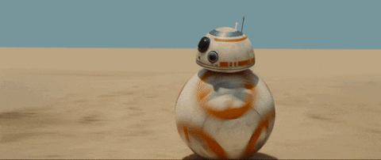

<!-- R2-D2 Header -->

  
    
  <samp>
    Hello! I'm <b>Evelyn Lacerda</b> 👋
  </samp>
   
  

<!-- Links Sociais e Acadêmicos em destaque -->

  
  &nbsp;
  
  &nbsp;
  

 

 

<!-- Seção de Tecnologias -->

  <samp><b>Tech Stack & Tools</b></samp>
    
  
  &nbsp;
  

 

 

<!-- Seção de Estatísticas (Fundo transparente para adaptar ao tema do usuário) -->

  <samp><b>GitHub Analytics</b></samp>
    
  
  
  
   
  
  

 

<!-- Rodapé com o BB-8 -->

  

